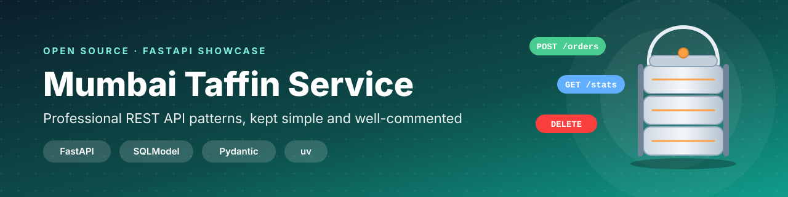
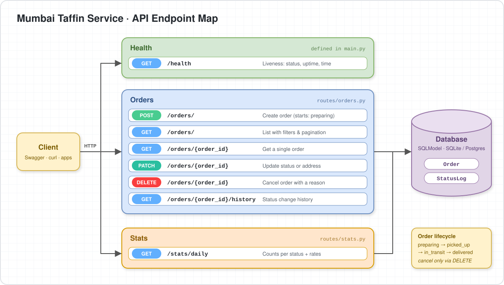

<div align="center">



<br/>


**A clean, beginner-friendly showcase of how to write professional API endpoints<br/>in FastAPI using SQLModel and Pydantic.**

[🚀 How to Run](#-how-to-run) · [📁 Folder Structure](#-folder-structure) · [🔌 API Endpoints](#-api-endpoints) · [🎨 Swagger UI](#-custom-swagger-ui) · [🤝 Contributing](CONTRIBUTING.md) · [📄 License](LICENSE)

</div>

---

## 📖 About the Project

**Mumbai Taffin Service** simulates a tiffin (lunch-box) delivery service. Customers place orders, and each order moves through a lifecycle: `preparing → picked_up → in_transit → delivered / cancelled`.

The domain is small on purpose. The goal is to show **how a real-world FastAPI project should be written**: simple, typed, validated and well-commented.

| 🧩 Pattern | 📍 Where to look |
| --- | --- |
| Table models vs. request schemas (SQLModel + Pydantic validation) | `models.py` |
| Dependency injection with `Depends(get_session)` | `database.py` |
| Custom exceptions with clear HTTP status codes | `exceptions.py` |
| Query validation, filtering and pagination | `routes/orders.py` |
| Business rules (status lifecycle, cancel with a reason) | `routes/orders.py` |
| Efficient `GROUP BY` aggregation | `routes/stats.py` |
| Lifespan events and a liveness health check | `main.py` |

---

## 🚀 How to Run

This project uses [**uv**](https://docs.astral.sh/uv/) and all dependencies live in `pyproject.toml` (`fastapi[standard]`, `python-dotenv`, `sqlmodel`).

**1. Install uv** (see the [official guide](https://docs.astral.sh/uv/getting-started/installation/)).

**2. Clone the repository**

```bash
git clone https://github.com/<your-username>/mumbai-taffin-service.git
cd mumbai-taffin-service
```

**3. Add a `.env` file** with your database URL (any SQLAlchemy-compatible URL works)

```env
DATABASE_URL=sqlite:///./taffin.db
```

**4. Start the server** (uv creates the virtual environment and installs everything for you)

```bash
uv run main.py
```

**5. Open the app**

| 🔗 Link | 📝 What |
| --- | --- |
| http://127.0.0.1:8000/docs | Custom Swagger UI |
| http://127.0.0.1:8000/health | Health check |

---

## 📁 Folder Structure

```text
mumbai-taffin-service/
├── assets/
│   ├── api-endpoints.svg     # API endpoint diagram
│   └── banner.svg            # README banner
├── custom_docs_ui/
│   ├── __init__.py           # exports setup_custom_docs
│   └── docs_ui.py            # custom Swagger UI served at /docs
├── exceptions/
│   ├── __init__.py           # exports the custom exceptions
│   └── exceptions.py         # custom HTTP exceptions
├── routes/
│   ├── __init__.py           # exports the routers
│   ├── orders.py             # create, list, get, update, cancel, history
│   └── stats.py              # daily statistics
├── .env.example              # sample environment variables
├── .gitignore
├── .python-version           # Python version used by uv
├── CONTRIBUTING.md
├── database.py               # engine, table creation, session dependency
├── LICENSE.md
├── main.py                   # app setup, lifespan and /health
├── models.py                 # SQLModel tables + Pydantic schemas
├── pyproject.toml            # dependencies (managed by uv)
├── README.md
└── uv.lock                   # locked dependency versions
```

---

## 🔌 API Endpoints

<div align="center">
  
</div>

---

## 🎨 Custom Swagger UI

The default FastAPI docs page is replaced by a custom-built, enhanced Swagger UI. It is switched on with two lines in `main.py`:

```python
app = FastAPI(..., docs_url=None)             # turn off the default /docs page
setup_custom_docs(app, docs_path="/docs")     # serve our custom UI instead
```

Run the project and open **http://127.0.0.1:8000/docs** to try every endpoint from your browser.

<!-- Add a screenshot of your custom UI here:
<div align="center"></div>
-->

---

## 🤝 Contributing & License

Contributions are welcome! Read the [**Contributing Guide**](CONTRIBUTING.md) for coding style and feature ideas.
This project is released under the [**MIT License**](LICENSE).

<div align="center">

⭐ **If this project helped you, please give it a star!** ⭐

</div>